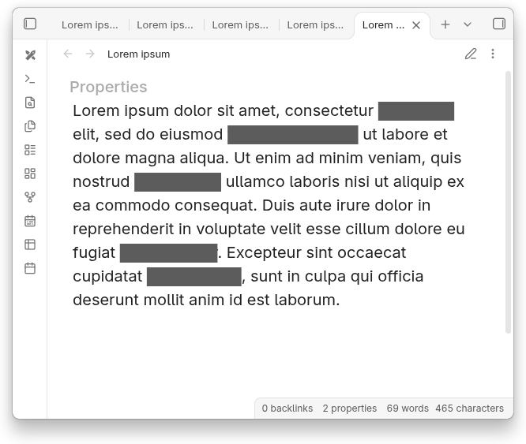
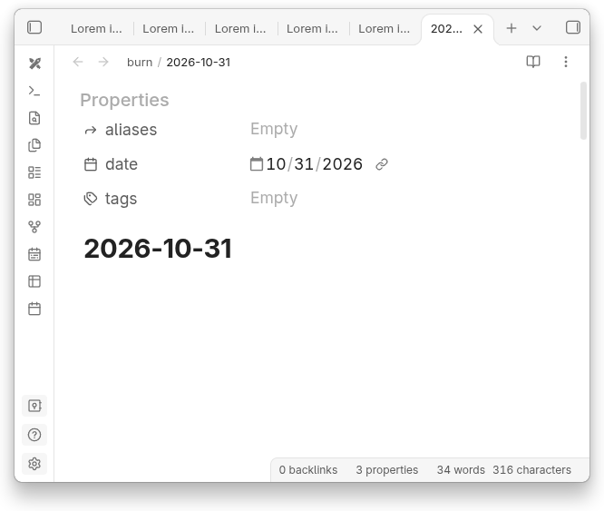
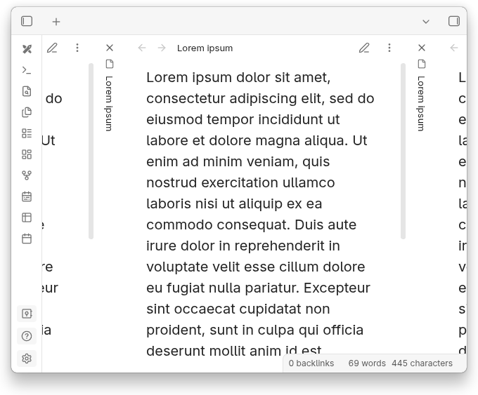
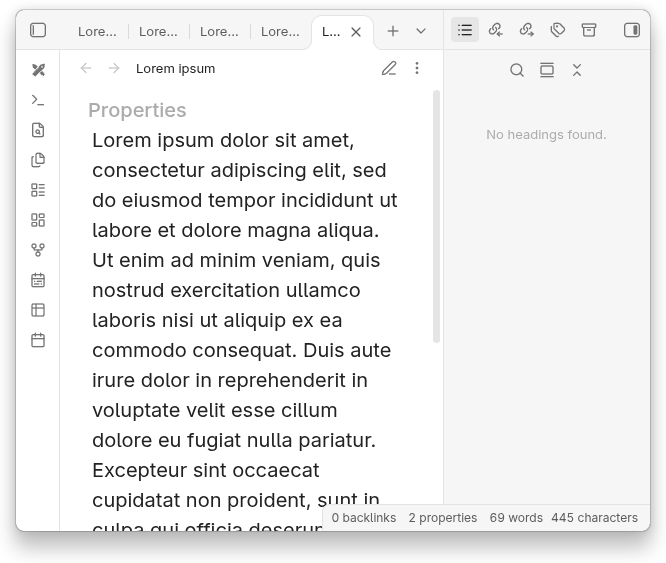
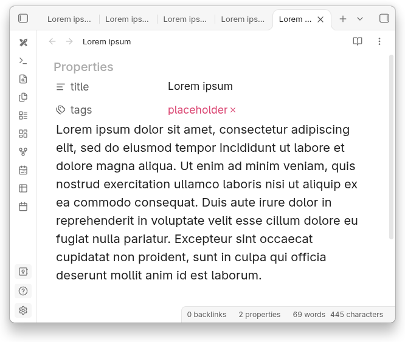

## Custom CSS snippets collection for [Obsidian.md](https://obsidian.md)

- [Download the archive](https://github.com/orca131/obsidian.snippets/archive/refs/heads/main.zip)
- Extract the archive content to the vault directory

## Basic features

Minor self-explanatory tweaks

- disable-tags-decorations
- disable-embed-title
- disable-completed-tasks-strike-through
- disable-tags-decorations
- enable-wide-popup-previews

## apply-spoiler2streikethrough

- Replace `~~strikethrough text~~` with coupures, visible on hover

## move-cmdr-buttons

- Move cmdr buttons from status bar to the left window edge
- [Commander](https://community.obsidian.md/plugins/cmdr) plugin is required
- Hide left pane dock

## disable-stacked-tabs

- Disable panes overlapping in stacked tabs mode

## disable-system-buttons

- Disable system buttons
- Move 'Toggle right sidebar' button to fixed position on window edge

## enable-compact-properties

- Reduce spacing around the properties container
- Hide unnecessary elements

